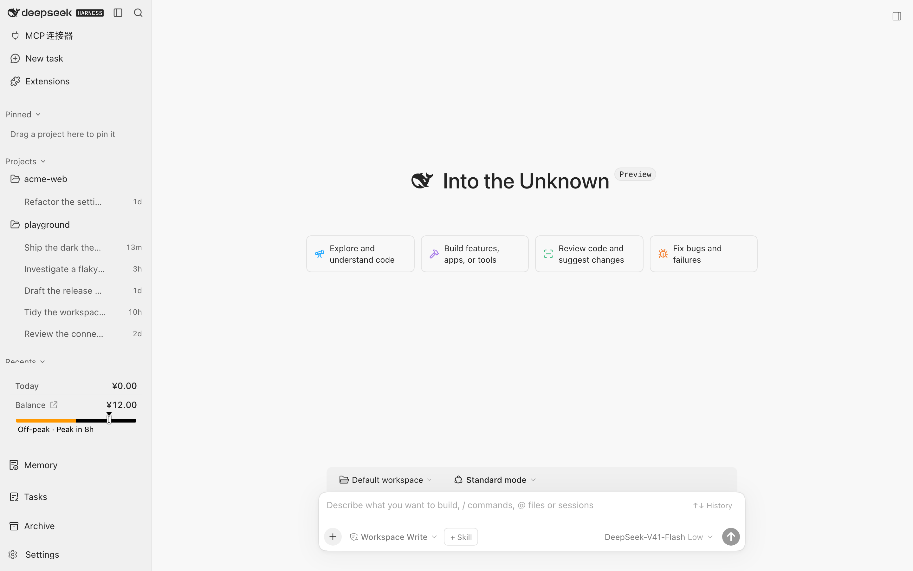
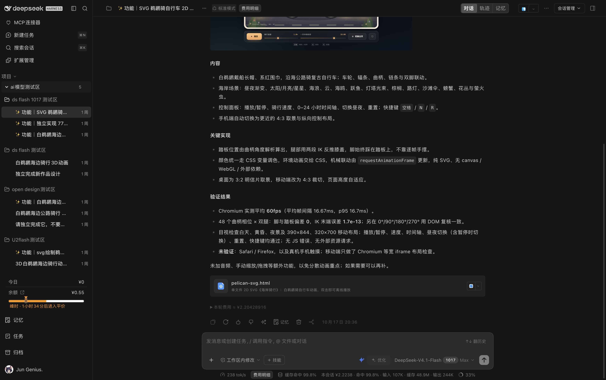
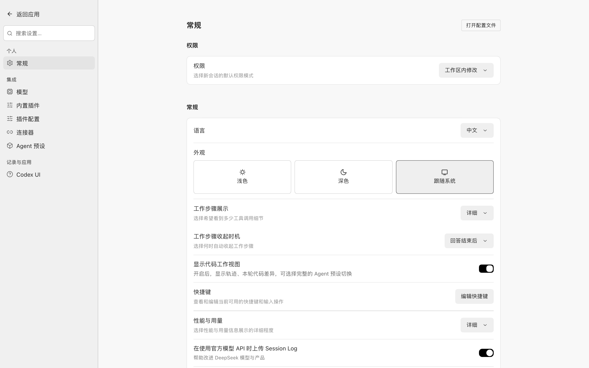
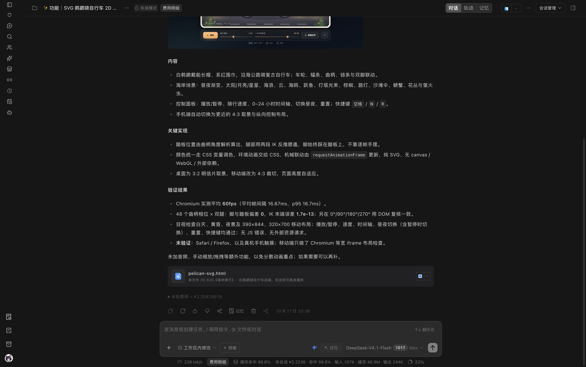
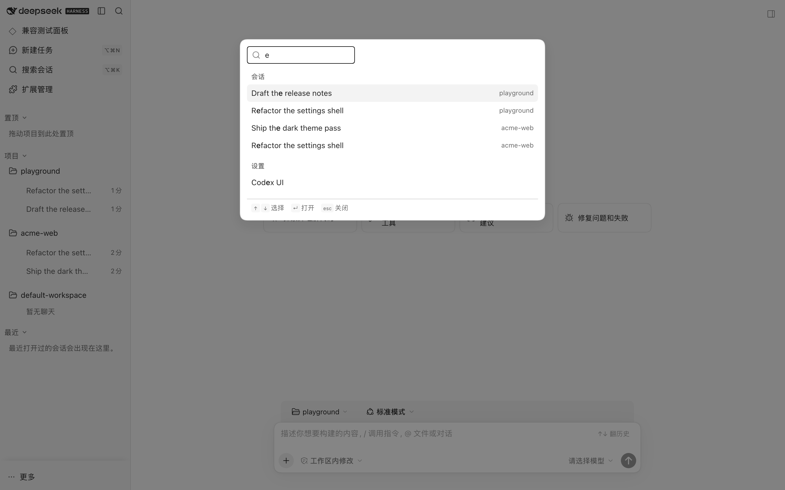
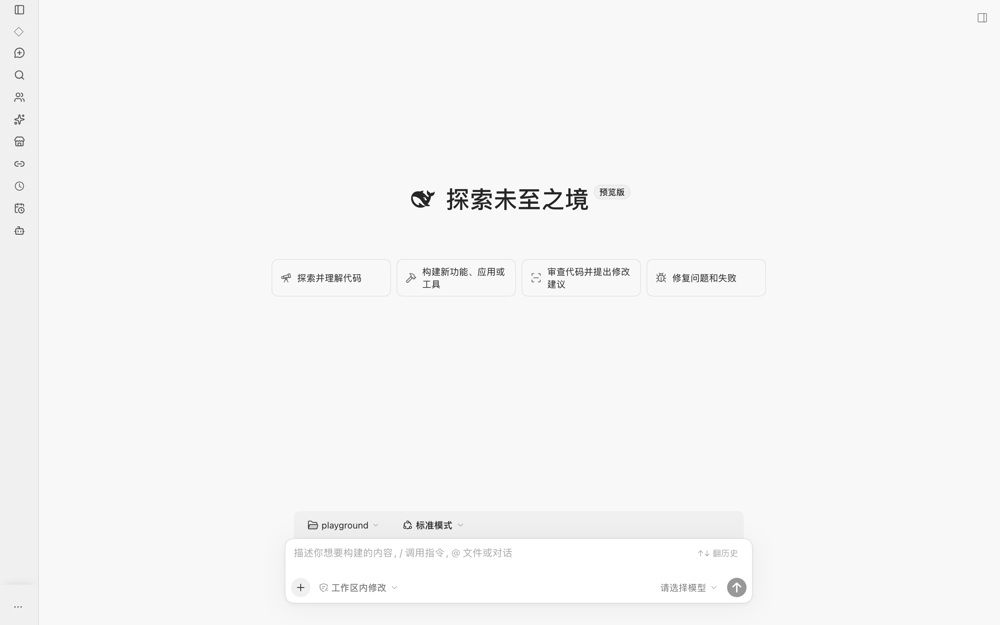

<p align="center">
  
  
</p>

<div align="center">

# DSH ZCode UI

**把 DeepSeek Harness（DSH）Web 的界面换成 ZCode 风格 —— 侧栏、工作区会话树、全局搜索、轮次导航**

[English](README.md) · [更新日志](CHANGELOG.zh-CN.md) · [Apache-2.0](LICENSE)

[](LICENSE)
[](https://github.com/jungenius-stack/dsh-zcode-ui)
[](https://nodejs.org/)

</div>

> [!IMPORTANT]
> **这是一个个人维护的第三方插件，没有任何官方背书。**
> 它**不是** DeepSeek AI 的产品，也**不是**任何机构的官方插件——它由个人（`jungenius-stack`）利用业余时间维护。
> 它派生自开源项目 [MichengAI/dsh-codex-ui](https://github.com/MichengAI/dsh-codex-ui)（Apache-2.0），设计值取自 [zai-org/ZCode](https://github.com/zai-org/ZCode)（Apache-2.0）。
> 「DeepSeek」「DeepSeek Harness」「ZCode」等名称归各自所有者，此处仅用于说明兼容性与设计来源。

---

## 每一个像素，都有出处。每一帧动效，都是刻意。

大多数皮肤是看着截图开始抄的。我们没有。

**dsh-zcode-ui** 是一个为期六周的设计继承工程的成果：没有任何东西——
一个圆角、一帧缓动——是靠猜的。我们用 Chrome DevTools Protocol 打开 ZCode 本体，
实时读取它的计算样式；解开它的启动页，逐字搬回关键帧；逐像素采样它的弹窗阴影。
然后，我们把这套语言在 DeepSeek Harness 里重建——14,480 行 TypeScript、85+ 模块、
一整个设计系统。

结果不是"模仿 ZCode"。是**在另一个应用里，原生地说 ZCode 的语言**。

而且它依然快：侧栏收起是一次 300ms 的滑动、**零长任务**；输入框在你的光标下
纹丝不动；启动的一瞬，你的应用图标在 macOS 毛玻璃上跃然而出、不到一秒就退场。

**实测，而非估算。守护，而非祈祷。**——这就是全部哲学，也是为什么这个皮肤
看起来不像换了个主题，而像 DeepSeek Harness 本该有的样子。

---

> [!NOTE]
> **自 2.0.0 起为稳定版（当前 2.1.0）。** 皮肤里的每一个视觉值都能追溯到对 ZCode 的实机测量（CDP 计算样式或源码提取），由 65 个契约断言、57 个单元/集成测试文件与 22 个真机布局脚本守护——`npm run gate` 一条命令全跑，`pre-push` 钩子在任何东西进入 GitHub 之前执行同一道门禁。已知限制依旧如实列在 [`docs/KNOWN-ISSUES.md`](docs/KNOWN-ISSUES.md) 里。
> **非常欢迎纠错和改进建议**——请直接开一个 [issue](https://github.com/jungenius-stack/dsh-zcode-ui/issues)。最有用的反馈很简短：你期望看到什么、实际发生了什么，如果是视觉问题就附一张截图。

DSH ZCode UI 把 DSH Web 的界面重新绘制成 ZCode（智谱 Zai）的视觉语言：侧栏、工作区会话树、头部搜索、输入框全部采用 ZCode 的几何、配色与图标，明暗两套主题都是。

**皮肤本身不改动别的东西。** 它绘制的一切仍然走 DSH 自己的 `SlotRegistry` 插槽与 `ctx` 公共服务，也从不写会话记录。

但有一点必须说清楚，因为上面这段话此前说宽了：本包是 [`dsh-codex-ui`](https://github.com/MichengAI/dsh-codex-ui) 的 fork，**同时继承了上游的非视觉功能**——一个能运行 `pnpm`、可重写 `node_modules` 的依赖面板，工作区之间的会话移动，以及「在文件管理器中打开」。它们继承自上游（不是本仓库写的），也是「关于」页里暴露的那部分。**只用皮肤、不用这些功能完全可以**，但它们确实随本包一起发布。详见[能力范围与权限](#能力范围与权限)。

## 成熟度

2.0.0 是六周设计继承工作的收官版本。每一个视觉决策——784px 正文列、32px 行高、两套弹窗语法、
动效令牌、启动画面——背后都是一条对 ZCode 本身的实测记录，而不是目测。完整台账在
[`docs/ZCODE-DESIGN.md`](docs/ZCODE-DESIGN.md)；被发现并关闭的缺口读起来就是 30+ 轮审计的
变更史（会话区排版、弹窗家族、轮次轨动效、启动画面、标题栏去重）——每一项都以
前后对照测量收口。

## 你会得到什么

不是一份主题文件。是一套在**令牌层**完整继承的设计系统——所有官方表面
明暗两套主题一体换色：

| 方面 | 皮肤做了什么 |
| --- | --- |
| **布局** | ZCode 侧栏几何——8px 圆角、32px 行高、`px-2 / py-3 / gap-1` 间距、150–200ms `ease-out` 动效、七档字号刻度 |
| **配色** | 完整的 Zai Light / Zai Dark 色板写入 DSH 的 `--dsw-*` 令牌层；标题栏、会话列表、按钮、菜单、输入壳等官方区域整体换色 |
| **图标** | 侧栏导航与行内操作使用 Lucide（与 ZCode 同一套图标库） |
| **主题** | 跟随宿主自身的明暗偏好（`body[data-ds-dark-theme]`）；亮色画布 `#f8f8f8`、暗色 `#161616` |
| **侧栏行为** | 项目与会话的置顶 / 分组 / 拖拽排序，未读与运行中指示；头部搜索覆盖会话、设置与快捷操作；重命名 / 归档 / 分叉 / 复制 / 删除；长会话轮次导航；空输入框按上/下键召回历史输入 |
| **会话工艺** | 784px 正文列、20px 轮组节奏、0.35px 字距、右对齐用户气泡可折叠、ZCode 级表格与引用块、围栏代码卡、禁止横向滚动 |
| **动效** | 按意图分档的动效令牌（进入 / 反馈 / 移动 / 按压），侧栏收起一次 300ms 滑动**零长任务**，入场动画共用一支——绝不同步失调 |
| **启动画面** | 电影感的启动层——你的应用图标在 macOS 毛玻璃上跃然而出，不到一秒退场，3 秒保险丝确保永远不会困住你 |
| **弹窗语法** | 一个家族作为唯一默认（独立设计评审 8/9 分）；重量级家族只留给阻断式确认——两族绝混用 |

## 界面截图

本页顶部的两张是明暗两套的侧栏与工作区会话树。另外几处。

> 所有截图里的项目名、会话标题与余额数字都是**演示数据**——提交前会先做脱敏，
> 因此本仓库里不会出现任何真实工作区的内容。
>
> **截图已按 2.0.0 重拍**（2026-10-29），对真实宿主（`0.2.1-rc.2`）取景：收起态窄轨、
> 置顶标题栏（宿主重复按钮已隐藏）、平贴的输入卡与表格/引用样式，就是 2.0 的实际出厂观感。
> 只有演示数据——本仓库不包含任何真实工作区内容。

设置页 —— 选中态是中性灰，与侧栏一致（没有宿主默认的蓝色残留）：



收起态窄轨——纯图标 + 顶部展开钮，页脚图标钉在底部（深色）：



头部搜索，覆盖会话与设置：



折叠后的窄轨 —— 纯图标，悬停有提示：



## 与上游的差别

本 fork 保留上游的交互脚手架与数据层，在此之上增加：

- **ZCode 皮肤本体**——明暗两套各 177 个 `--dsw-*` 令牌，另加 23 个结构性令牌，合计 200 个唯一令牌名。`src/` 中出现的每一个被消费令牌都在映射表里，`token-coverage` 断言会在这一点不再成立时直接让构建失败。
- **主题单一真源**——只认宿主属性，不做 `prefers-color-scheme` 回退。旧做法在「宿主是亮色、系统是暗色」时会把侧栏与内容区撕成两半。
- **靠看真实界面发现的修复**，而不是靠读代码：会话悬停卡精简为只显示标题；发送键使用真正的主色（`--dcu-primary` 现在定义在 `:root`，输入区在 `.dcu-root` 之外才能解析到它）；全局面板打开时提供「返回会话」入口；删掉侧栏自绘的分隔线；标题跑马灯不再裁掉两端；底栏分组分隔；空状态卡收矮。
- **一套真能跑起来的验证栈**——见[验证](#验证)。上游那批真浏览器布局脚本此前在本机**从未真正执行过**（缺 Chromium 二进制），这也正是 5 条过期断言长期没被发现的原因。

## 能力范围与权限

一个皮肤本不该需要一段权限说明。这个需要，因为它是 fork，继承的不只是视觉。说清楚比「被默认信任」便宜。

| 能力 | 从哪里触发 | 会碰什么 |
| --- | --- | --- |
| 给界面换色 | 安装即生效 | DSH 的 `--dsw-*` 令牌层与本插件自己的样式表。不碰数据。 |
| 侧栏 / 会话树 / 搜索 | 安装即生效 | 走官方插槽渲染。读取会话与工作区列表；从不写会话记录。 |
| 依赖面板 | 「关于」页，点击触发 | 在当前工作区运行 `pnpm`，可重写 `node_modules` 与 `pnpm-workspace.yaml`。 |
| 移动会话到工作区 | 会话右键菜单 | 重写该会话的工件文件。 |
| 在文件管理器中打开 | 路径菜单 | 打开系统文件管理器。只读。 |
| 五个 REST 端点 | 仅本插件自己的界面 | 承载上面四项功能；按会话鉴权。 |

下表后四行**全部继承自 [`dsh-codex-ui`](https://github.com/MichengAI/dsh-codex-ui)**，并且在 DSH 内的「关于」页也一并暴露。只要皮肤的话，这些功能你不点就不会运行。

## 环境要求

- 一个可用的 **DeepSeek Harness Web**，且 `dsh` 在 `PATH` 上。下文示例使用 `web` profile，请替换成你自己的 profile 名。
- **主机兼容性。** peer 依赖声明的 `@deepseek-ai/dsh-client-*` 范围为 `>=0.1.6-alpha.2 <0.3.0-0`，开发期固定为 `0.2.0-rc.2`。重型档 `pnpm gate:host` 会把插件打包、装进隔离的 `DSH_HOME`，并用本机真实的 `dsh` 二进制跑一遍安装链路（可用 `DCU_DSH_BIN` 覆盖）。
- 从源码构建需要 **Node.js `^22.19.0 || >=24.0.0`**。
- ⚠️ macOS 上构建或测试时，**不要**把 DSH 自带的 Node 24 放在 `PATH` 最前面：它加载不了 `rolldown` 的原生绑定（`code signature ... different Team IDs`），`vitest` / `tsdown` 会直接失败。换成任意 22.22.x 即可。

## 安装

本包**未发布到 npm 仓库**，直接从 GitHub 安装即可——`dsh plugin` 会把参数原样转发给 `pnpm`，
而 pnpm 原生支持 `github:<owner>/<repo>` 这种写法：

```text
dsh plugin --profile web add github:jungenius-stack/dsh-zcode-ui
```

`lib/` 已随仓库提交，且本包没有 `prepare` 脚本，所以安装过程不会触发任何编译。

### 让智能体帮你装（推荐）

把下面这段发给任何能执行终端命令的智能体：

```text
请把 DSH 插件 dsh-zcode-ui 装进我本地的 web profile，执行：
dsh plugin --profile web add github:jungenius-stack/dsh-zcode-ui
然后运行 dsh --profile web --dump-config，确认配置里出现 zcode-ui，并告诉我怎么重载 DSH、怎么开始使用这套皮肤。
```

### 手动安装

```powershell
[Console]::OutputEncoding = [System.Text.Encoding]::UTF8
$OutputEncoding = [System.Text.Encoding]::UTF8
dsh plugin --profile web add github:jungenius-stack/dsh-zcode-ui
dsh --profile web --dump-config
```

重启 DSH Web 并硬刷新浏览器（一般是 `Ctrl+Shift+R`）。看到新侧栏就说明皮肤生效了。停用或卸载插件即可恢复官方界面。

### 从本地克隆安装（用于未发布的改动）

```powershell
[Console]::OutputEncoding = [System.Text.Encoding]::UTF8
$OutputEncoding = [System.Text.Encoding]::UTF8
git clone https://github.com/jungenius-stack/dsh-zcode-ui.git
Set-Location .\dsh-zcode-ui
pnpm install --frozen-lockfile
pnpm build
dsh plugin --profile web add .
dsh --profile web --dump-config
```

`lib/` 已随仓库提交，克隆下来不构建也能用——但改过 `src/` 后必须重新构建。**装依赖必须用 `pnpm`**：`pnpm-workspace.yaml` 用 `packageExtensions` 为 `@deepseek-ai/dsh-client-ui-primitives` 补了 19 个未申报依赖，而 `npm` 不读这套机制，`npm install` 之后 `tsdown` 会因为解析不到这些包而失败。只有在依赖已用 pnpm 装好的前提下，「用 `npm run <script>` 执行脚本」才是等价的。

## 使用

重载 DSH Web 后，左侧导航就由本插件渲染。

| 想做什么 | 怎么做 |
| --- | --- |
| 开新会话 | **新建任务**，或用工作区上的 **+** / **新建会话** |
| 找东西 | 在头部搜索框输入，从会话、设置页、快捷操作里挑 |
| 收起侧栏 | 头部面板按钮；收起后的窄条上仍留有展开控件 |
| 从全局面板返回 | 面板打开时，面板入口正下方会出现**返回会话** |
| 置顶项目 | 把它拖进**置顶**区，或用项目菜单里的**置顶项目** |
| 管理会话 | 打开会话菜单：重命名、置顶、标记未读、归档、分叉、复制、删除 |
| 复用历史输入 | 空输入框按上/下键，召回本工作区提交过的内容 |
| 在轮次间跳转 | 用当前会话左侧的轮次标记 |

## 常见问题

**装完了，界面没变化？**
先确认你装的 profile 就是正在运行 DSH Web 的那个，然后重启 DSH Web 并硬刷新浏览器（`Ctrl+Shift+R`）。`dsh --profile web --dump-config` 的输出里应该能看到 `zcode-ui`。如果该 profile 的 `cordis.patch.yml` 里还留着 `ui-sidebar` 或 `ui-settings-general` 的 `disabled: true`，把那几行删掉再重载。

**会不会动我的会话、工作区或文件？**
皮肤本身不会。它只通过 DSH 的 `--dsw-*` 令牌层给界面换色，并通过官方插槽与公共服务渲染侧栏。它从不写会话记录；把项目从侧栏移除也不会删除任何文件夹。

有两项**继承来的**功能确实会碰文件，但只在你主动使用时：依赖面板会运行 `pnpm` 并可重写 `node_modules`，「移动会话到工作区」会重写该会话的工件文件。详见[能力范围与权限](#能力范围与权限)。

**能和别的 DSH 插件一起用吗？**
可以，与 profile 里的其他插件共存。需要说明的是：实机反馈的 4 个界面问题实际属于计费插件与 context-pilot，不归本插件——详见 [`docs/KNOWN-ISSUES.md`](docs/KNOWN-ISSUES.md)。

**为什么有 3 个断言是跳过的？**
它们校验的是上游 monorepo 的发布契约（`packages/`、`.github/workflows/`），而本仓库是单包 fork，被测对象不存在。文件被保留并加显式 `SKIP` 块，而不是删除——见[已知限制](#已知限制)。

**这是官方插件吗？**
不是。这是个人项目，没有得到任何方面的背书（见文首声明）。

## 验证

四层，都能在本地跑。`npm run gate` 把它们串成一条，`pre-push` 钩子会自动执行；耗时与用例数见 [`docs/BASELINE.md`](docs/BASELINE.md) 的实跑快照（本机正常负载下是分钟级，别按"几十秒"安排）：

| 层级 | 命令 | 覆盖范围 |
| --- | --- | --- |
| 类型 | `npm run typecheck` | `tsc --noEmit`，覆盖 `src` 与 `tests` |
| 单元 / 集成 | `npm run test:unit` | 58 个文件（用例数见 [`docs/BASELINE.md`](docs/BASELINE.md)） |
| 契约断言 | `node tests/run-assertions.mjs` | 65 个脚本（通过 / 跳过见 [`docs/BASELINE.md`](docs/BASELINE.md)） |
| 真机布局 | `npm run test:layout` | 22 个 Chromium 脚本，量真实几何、交互、对比度与溢出 |

`npm run gate:host` 是重型档：把插件打包、装进一个隔离的 `DSH_HOME`、起真实的 `dsh web`，再跑三个活宿主脚本（约 1–2 分钟）。改动插槽、注入或安装流程时用它。

布局脚本需要一次性安装 Playwright 自带的 Chromium：`./node_modules/.bin/playwright install chromium`。

## 已知限制

都在 [`docs/KNOWN-ISSUES.md`](docs/KNOWN-ISSUES.md) 里如实记录——那份文件是唯一真源，以下每一条在其中都有完整展开：

- **有 3 个断言是有意跳过的。** 它们校验的是上游 monorepo 的发布契约（`packages/`、`.github/workflows/`），而本仓库是单包 fork，被测对象根本不存在。文件被保留并加显式 `SKIP` 块，而不是删除——删除会让「测试不见了」和「问题解决了」难以区分。
- **兼容性边界：构建在 0.2.0-rc.2，日常运行在 0.2.1-rc.2。** `engines.dsh` 与 11 个 peer 的下界都是 `>=0.2.0-rc.2`（因为 `devDependencies` 钉在那里，本仓从未在更早的宿主上编译过）。上界保持 `<0.3.0-0` 是有意的：作者本人每天在 0.2.1-rc.2 上用它，收窄会把你挡在版本门禁外；但 0.2.1 确实没有进入构建与门禁——这个差别写在这里，而不是藏在一个看起来很宽的范围里。
- **实机反馈的 7 个界面问题里，有 4 个不归本插件。** 它们被查到属于计费插件与 context-pilot（费用重复显示、状态栏拥挤），以及宿主内置控件；已记录在案，没有静默忽略。
- **上游两个 issue（[#40](https://github.com/MichengAI/dsh-codex-ui/issues/40)、[#41](https://github.com/MichengAI/dsh-codex-ui/issues/41)）经探测未复现**（macOS、四种窗口尺寸）。两句都已不再是「未结」：上游于 2026-10-13 以 `state_reason=completed` 关闭（2026-10-18 复核）。非 macOS 平台、真实系统缩放、全屏/分屏仍未验证。
- **CI 配置已就绪，但还差一次手动启用。** [`docs/ci/workflow-ci.yml`](docs/ci/workflow-ci.yml) 就是那条 workflow：push 与 PR 上执行 `pnpm install --frozen-lockfile` 加 `node scripts/gate.mjs`，与 `pre-push` 钩子是同一份，所以「本地绿 == CI 绿」由同一个命令保证。它没能直接落在 `.github/workflows/`：用于推送的凭据只有 `repo` scope，GitHub 拒绝创建 workflow 文件（`refusing to allow an OAuth App to create or update workflow ... without workflow scope`）。把它复制到 `.github/workflows/ci.yml` 并 push，或换一个带 `workflow` scope 的 token，即可启用。**在那之前，门禁只在本地的 `pre-push` 上跑。** 本机 `node_modules` 处于手工修补状态（为绕开 `tsdown` 的依赖缺口），重新 `npm install` 后可能需要重新打补丁。

## 参考资料与致谢

没有这些项目，就没有这个插件：

| 项目 | 在这里的角色 |
| --- | --- |
| [MichengAI/dsh-codex-ui](https://github.com/MichengAI/dsh-codex-ui)（Apache-2.0） | fork 的父项目——侧栏、工作区会话树、搜索、轮次导航、设置骨架、测试工具链与数据层思路都来自它。本 fork 基于它的 `1.1.34`，再加上 ZCode 皮肤与上述修复。 |
| [zai-org/ZCode](https://github.com/zai-org/ZCode)（Apache-2.0） | 设计来源——色板、几何、图标选型与动效值均取自它（已与 v3.15.1 逐项核对）。 |
| [DeepSeek Harness](https://github.com/deepseek-ai/deepseek-harness) | 本插件所挂载的宿主程序。 |
| [Lucide](https://lucide.dev/) | 侧栏使用的图标库。 |

仓库内值得一读的存档：

- [`docs/ZCODE-DESIGN.md`](docs/ZCODE-DESIGN.md) —— 从 ZCode 提取的完整设计规范。
- [`docs/KNOWN-ISSUES.md`](docs/KNOWN-ISSUES.md) —— 已知问题、跳过的断言、环境遗留、发布前检查清单。
- [`docs/UPSTREAM-CHANGELOG.md`](docs/UPSTREAM-CHANGELOG.md) —— fork 点之前的上游更新日志。
- [`CONTRIBUTING.md`](CONTRIBUTING.md) —— 怎么构建、怎么验证、怎么提交。

## 反馈与贡献

这是一个**测试版**，且由一个人维护，所以反馈是它变好的主要途径。

- **哪里不对、哪里难看？** 开一个 [issue](https://github.com/jungenius-stack/dsh-zcode-ui/issues)：说明你期望什么、实际发生了什么，视觉问题请附截图——侧栏与输入框的截图最有用。
- **有想法或改进建议？** 同样开 issue 就行，没有别的流程。
- **想直接提交改动？** 见 [CONTRIBUTING.md](CONTRIBUTING.md)——提交前 `pnpm gate` 必须全绿。
- **报之前先扫一眼** [`docs/KNOWN-ISSUES.md`](docs/KNOWN-ISSUES.md)：已知限制都写在里面了，包括哪些问题**不归本插件**。

## 开发

```bash
pnpm install --frozen-lockfile
pnpm build          # tsc --noEmit && tsdown  → lib/
pnpm gate           # 类型 + 断言 + vitest + 22 个浏览器脚本
pnpm gate:host      # 隔离真实宿主的兼容性重型档
```

所有脚本都是 `package.json` 里的普通条目，用 `npm run build` / `npm run gate` 效果完全一致。

改完 `src` 要先构建再安装或提交。新功能应复用 DSH 既有插槽与公共服务，不要依赖宿主私有 DOM，也不要写会话记录。

## License

[Apache License 2.0](LICENSE)，与上游脚手架及 ZCode 设计来源一致。上游的版权与署名声明均予保留。
